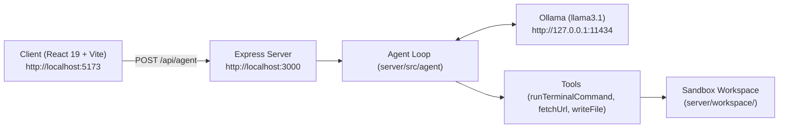

# Local Agent Orchestrator

> A local AI agent orchestrator powered by Ollama (`llama3.1`) with autonomous tool calling, an Express backend, and a retro terminal UI.

## Features

- **Autonomous Agent Loop**: Multi-turn tool execution powered by Ollama's function calling with a safety iteration limit.
- **Tools**:
  - `runTerminalCommand`: Executes native Windows shell commands with automatic timeout handling.
  - `fetchUrl`: Fetches web pages with automatic payload truncation to preserve model context.
  - `writeFile`: Writes files cleanly with automatic directory creation.
- **Sandboxed Workspace**: File operations and command executions are scoped to `server/workspace/`.
- **Retro Terminal Interface**: React 19 + Vite frontend styled with JetBrains Mono, auto-scrolling message stream, and animated execution indicators.

## Architecture



## Project Structure

```
Phase 1/
├── client/                     # Vite + React terminal frontend
│   ├── public/favicon.svg      # Terminal SVG icon
│   ├── src/
│   │   ├── api/agent.js        # API client wrapper
│   │   ├── components/         # Terminal component and styling
│   │   ├── App.jsx
│   │   ├── main.jsx
│   │   └── index.css           # Global tokens and reset
│   ├── index.html
│   └── vite.config.js          # API proxy to backend
├── server/                     # Express backend + Ollama agent
│   ├── src/
│   │   ├── index.js            # Express server entry point
│   │   ├── config.js           # Env config & workspace directory setup
│   │   └── agent/
│   │       ├── agent.js        # Multi-turn tool-calling loop
│   │       ├── prompts.js      # System prompt
│   │       └── tools/          # Tool schemas and handlers
│   ├── workspace/              # Agent sandbox working directory
│   ├── .env.example
│   └── package.json
├── examples/                   # Standalone SDK experiments
│   └── gemini/                 # Gemini function calling & structured output
├── .gitignore
├── package.json                # npm workspaces root
└── README.md
```

## Prerequisites

- **Node.js**: v20 or newer
- **[Ollama](https://ollama.com)** installed and running locally
- Pull the default model:
  ```bash
  ollama pull llama3.1
  ```

## Setup & Run

1. **Install dependencies** at the project root:
   ```bash
   npm install
   ```

2. **Configure environment variables** for the server:
   ```bash
   cp server/.env.example server/.env
   ```
   *(On Windows PowerShell: `Copy-Item server\.env.example server\.env`)*

3. **Start development servers** (runs server on `3000` and client on `5173` concurrently):
   ```bash
   npm run dev
   ```

4. Open [http://localhost:5173](http://localhost:5173) in your browser.

## Configuration

The backend supports the following environment variables (configured in `server/.env`):

| Variable | Default | Description |
|---|---|---|
| `PORT` | `3000` | HTTP port for the Express backend |
| `OLLAMA_HOST` | `http://127.0.0.1:11434` | URL of the local Ollama daemon |
| `OLLAMA_MODEL` | `llama3.1` | Model name to use for agentic tool calling |
| `AGENT_MAX_ITERATIONS` | `10` | Maximum tool-call turns per request |
| `COMMAND_TIMEOUT_MS` | `10000` | Timeout in milliseconds for shell commands |

## API

### `GET /api/health`
Checks server status and configured model.
```json
// Response 200 OK
{
  "status": "ok",
  "model": "llama3.1"
}
```

### `POST /api/agent`
Sends a user message to the agent orchestrator.
```json
// Request Body
{
  "message": "Create a file named notes.txt with a brief greeting."
}

// Response 200 OK
{
  "reply": "I have created 'notes.txt' inside the workspace with the requested greeting."
}
```

## ⚠️ Security Note

The agent has access to `runTerminalCommand`, which executes shell commands on your host system. While file writes are restricted to `server/workspace/` and commands run with that directory as their working directory, shell commands themselves are **not sandboxed** from the underlying operating system. Run this application only in trusted local environments and **never** expose this API publicly.
